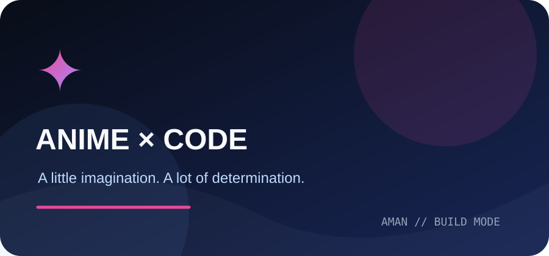
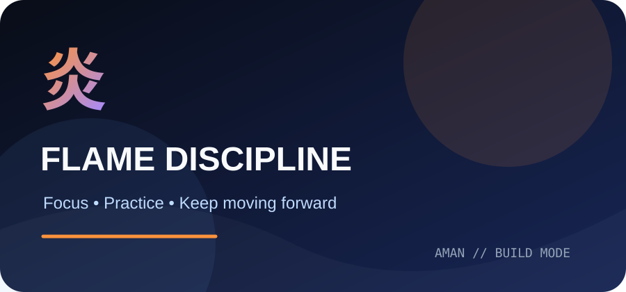
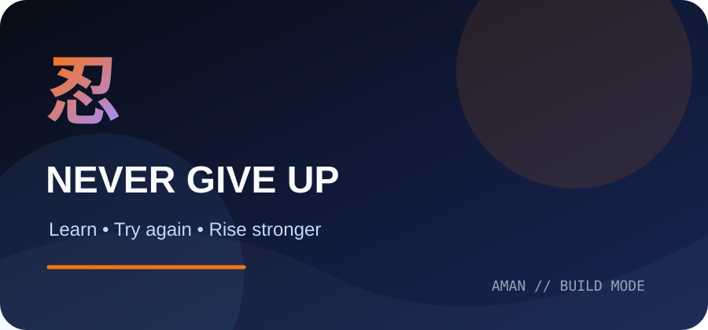
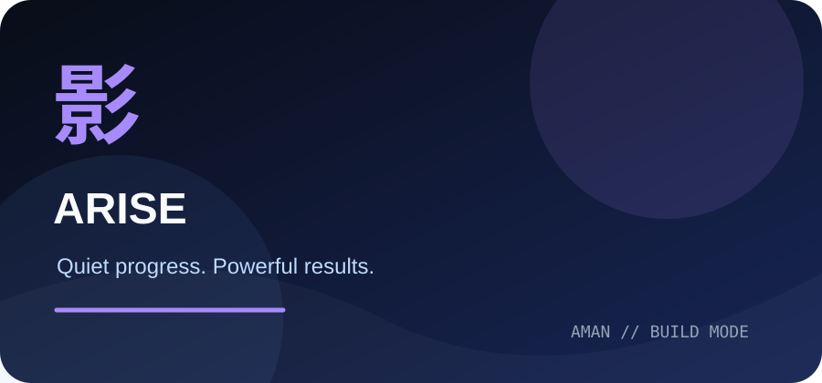
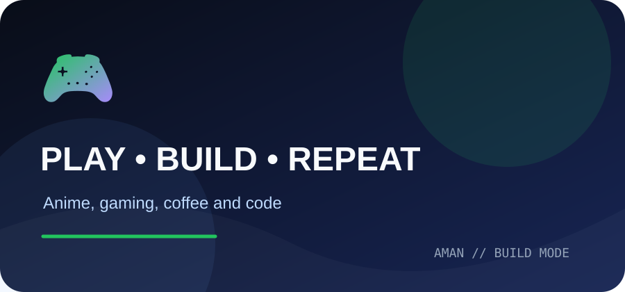

<!-- ==================== HEADER ==================== -->

👋 About Me

Hi! I'm Aman Prasad Das.

I'm a B.Tech Computer Science & Engineering student at GIFT Autonomous College.

I enjoy learning programming, creating projects and exploring new technologies.
💻 I Like
- Backend Development
- Full-Stack Development
- React
- Node.js
- MongoDB
- Python
- Java
- AI / Machine Learning
🎯 My Goal
Learn → Build → Practice → Improve
🛠️ Skills

Languages

Frontend

Backend

Database

Tools

🚀 My Projects
🍽️ TasteBite
Restaurant Management Platform
A full-stack restaurant management project.

Features
- 🔐 Authentication
- 🍔 Restaurant Dashboard
- 🛒 Cart
- 📦 Order Management
- 💳 Payments
- 🔌 REST APIs
Tech Stack

React Node.js Express.js MongoDB JWT

💰 FinVerse AI
AI Finance Dashboard
An AI-powered finance project.

Features
- 💱 Currency Converter
- 📊 Finance Dashboard
- 🤖 AI-assisted Financial Insights
Tech Stack

React Node.js AI/ML

🌱 EcoTrack AI
AI Sustainability Platform
A project focused on tracking environmental impact using AI/ML.

Tech Stack

Python Node.js AI/ML

🔗 URL Shortener
A URL-shortening service with analytics.
Long URL
   ↓
Backend
   ↓
Short URL
   ↓
Redirect
   ↓
Analytics
Tech Stack

Node.js Express.js MongoDB

🧩 AI Jigsaw Solver
A machine-learning project that reconstructs scrambled jigsaw pieces.

Tech Stack

Python CNN Graph Neural Network

🏆 3rd Place — ML Hackathon

🎯 ~92.4% reported accuracy

🎌 Anime Corner

⚔️ Demon Slayer

🔥 Tanjiro Kamado
Keep moving forward.

Focus • Practice • Patience

🍥 Naruto

🍥 Naruto Uzumaki
Believe it! 🔥

Keep Learning • Keep Trying • Never Give Up

🖤 Solo Leveling

🖤 Sung Jin-Woo
Arise.

Learn • Practice • Improve

🎮 Anime × Gaming × Coding

       🎌 ANIME
          +
       🎮 GAMING
          +
       💻 CODING
          +
        ☕ COFFEE
          =
       ❤️ HAPPINESS

💼 Experience
🔧 Backend Development Intern
Web Bocket Software Pvt. Ltd.
Worked on backend and full-stack development using:

Node.js Express.js MongoDB REST APIs Authentication
💻 Programming Fundamentals Intern
IIG Varsity, Bhubaneswar
Strengthened programming fundamentals as a foundation for backend and full-stack development.
🎓 Education

B.Tech — Computer Science & Engineering
GIFT Autonomous College

2023 – 2027

📍 Odisha, India

🏆 Achievements

Achievement	Result
🚀 Software Projects	12+
🥉 ML Hackathon	3rd Place
🤖 AI Jigsaw Solver	~92.4%
📜 IBM SkillsBuild	Certified

📚 Currently Learning

🎯 My Goals
- 🚀 Build better projects
- 💻 Improve backend development
- 🧠 Learn more about system design
- 🤖 Build more AI/ML projects
- 🌐 Improve full-stack development
- 🤝 Contribute to open source
- 📚 Keep learning every day
🧪 Beyond the Usual Projects
I enjoy building technology that solves practical problems, not just completing tutorials.
🎓 DishaSetu — Student Career Platform
A platform concept focused on connecting students with job and internship opportunities.
- Student job and internship discovery
- Application status tracking
- Corporate job management
- Offer-letter upload and viewing
- Student profile and application details
React TypeScript Python PostgreSQL
🦺 SafetySync Pro — Workplace Safety Platform
A safety-focused platform concept for improving HSE reporting and workplace awareness.
- Incident reporting and tracking
- Training and meeting records
- Rectification workflows
- Good-practice reporting
- Smart photo intelligence and incident heatmaps
React Node.js AI/ML
💧 AquaFlow — Water Supply Management
A water-supply project where I worked on the frontend experience.
- User-friendly interface
- Clear water-service information
- Responsive frontend design
Frontend Development JavaScript HTML CSS
🧠 How I Approach Development
Understand the problem
        ↓
Plan the solution
        ↓
Build and test
        ↓
Learn from mistakes
        ↓
Improve and ship
I believe good development is not about writing the most code.
It's about building something useful, reliable, and easy to use.
🤝 Open to Collaboration
I'm interested in collaborating on:
- Full-stack web applications
- Backend APIs and database-driven projects
- AI/ML experiments
- Student-led and hackathon projects
- Open-source contributions
If you're building something interesting, let's connect and create something meaningful.
📊 GitHub Stats

🐍 My Contributions

🌟 A Little More About Me

💻 Coding	🎮 Gaming	🎌 Anime	🤖 AI
❤️	❤️	❤️	❤️

I enjoy coding, gaming, anime and learning new things.

🤝 Let's Connect

💻 Code • 🎮 Game • 🎌 Anime • 🤖 AI • 🚀 Build

